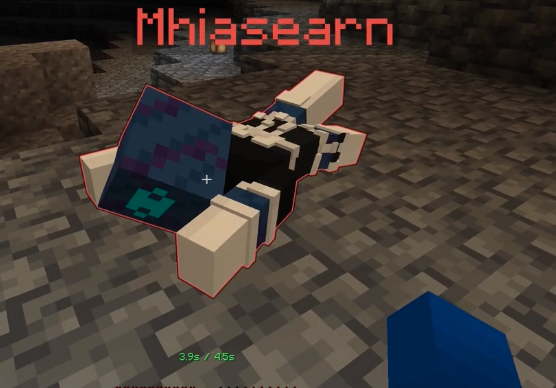

# Minecraft 26.3 friends guide

## Get started

> [!TIP]
> **Just joining? This is the only section you need.** You do not need to install mods or datapacks.

1. [Install Tailscale](https://tailscale.com/download) on the computer you play on, then **sign in**.
2. Ask Darren for a **Tailscale invitation** and the **server address**.
3. Open Darren's invitation link and select **Accept**. Keep Tailscale **connected**.
4. Launch **Minecraft: Java Edition 26.3**. Open **Multiplayer → Add Server**.
5. Enter Darren's private Tailscale address **with `:25565` at the end** (for example, `100.x.y.z:25565`), then join.

**Optional resource pack (client-side):** For matching quality of life + visuals, download the [Friends Survival resource pack](https://github.com/gypsymagic236/minecraft-26.3-friends-pack/releases/latest/download/Friends-Survival-26.3.zip). 
In Minecraft, open **Options → Resource Packs → Open Pack Folder**, put the ZIP there **without extracting it**, and move it into the active column.

> [!TIP]
> **You're ready to play. You can stop reading here.** Everything below is an optional reference for mods, commands, and server features.

---

## More Details

**Jump to:** [Progression Guide Mod](#progression-guide-mod) · [Commands](#controls-and-commands) · [Automatic features](#things-that-happen-automatically) · [Installed packs](#server-datapacks-and-plugins)

### Progression Guide Mod

Press **L** (or your Advancements key) to browse [BlazeandCave's Advancements Pack](https://modrinth.com/datapack/blazeandcaves-advancements-pack). Its themed tabs offer goals for mining, building, exploring, farming, the Nether, the End, and more. **Progress is shared:** when one of us completes a goal, it counts for everyone. The pack is on the server, so there is nothing to download. Bonus item and XP rewards are off.

Peek at three tabs from the [creator's gallery](https://modrinth.com/datapack/blazeandcaves-advancements-pack/gallery):

| Mining | Building | Farming |
| :---: | :---: | :---: |
|  |  |  |

**If a goal does not register:** Server ops can mark it complete by typing `/advancement grant @s only blazeandcave:bacap/getting_wood` in Minecraft chat. This example grants **Getting Wood**; replace `bacap/getting_wood` with the goal's ID for another advancement (use **Tab** to complete IDs). The completion is then shared with the group.

### Controls and commands

Type commands in Minecraft chat (press **T**). **Sneak** means your normal sneak key, usually **Left Shift** unless you changed it.

#### Inventory and chests

| Feature | What to do |
| --- | --- |
| Sort your inventory | `/neatsort inv` — manual only; leaves your hotbar alone |
| Sort an open chest | **Shift + left-click** an empty chest slot |
| Put matching items into an open chest | **Shift + right-click** an empty chest slot |
| Pull everything from an open chest | **Left-click outside** its slots |
| Put away items into an open chest | **Right-click outside** its slots to push as much as will fit |

#### Mining and building

| Feature | What to do |
| --- | --- |
| VeinMiner | **Sneak while mining ore**; up to 32 connected ore blocks; each block uses tool durability |
| Excavating | **Sneak with an Excavating-enchanted pickaxe or shovel** to mine a 3 × 3 × 3 area; each block uses durability |
| Timber | Break a tree with an axe **while standing** to fell it; leaves clear and saplings drop as items |

| [VeinMiner](https://modrinth.com/project/OhduvhIc) | [Excavating](https://modrinth.com/project/pKiI1vdn) |
| :---: | :---: |
|  |  |

#### Travel and waypoints

| Feature | What to do |
| --- | --- |
| Waypoint markers | `/trigger waypoint` opens personal and global markers |
| Rename a waypoint | Stand within 4 blocks and type `/wpname <new name>`; free to rename |
| Crafted Waystones | Craft and place a Waystone, then use it to travel to another in the **same dimension** |
| Set and use your one home | `/trigger sethome` and `/trigger homes` |
| Return to a previous location | `/trigger back`; after a final death it returns to the death location |

Travel commands are instant and have no cooldown. Waystones are public by default, free to use after crafting, unlimited per player, and anyone can break a placed one. The recipe uses **1 [Lodestone](https://minecraft.wiki/w/Lodestone), 1 [Eye of Ender](https://minecraft.wiki/w/Eye_of_Ender), 2 [Amethyst Shards](https://minecraft.wiki/w/Amethyst_Shard), and 3 matching base blocks**.

**Base blocks:** [Andesite](https://minecraft.wiki/w/Andesite), [Sandstone](https://minecraft.wiki/w/Sandstone), [Nether Bricks](https://minecraft.wiki/w/Nether_Bricks), [Mossy Stone Bricks](https://minecraft.wiki/w/Mossy_Stone_Bricks), [Cobbled Deepslate](https://minecraft.wiki/w/Cobbled_Deepslate), [Copper Block](https://minecraft.wiki/w/Copper_block), [Prismarine Bricks](https://minecraft.wiki/w/Prismarine_bricks), [Tuff](https://minecraft.wiki/w/Tuff), [Red Sandstone](https://minecraft.wiki/w/Red_Sandstone), or [Quartz Block](https://minecraft.wiki/w/Blocks_of_quartz).

| [Better Waypoints](https://modrinth.com/datapack/better-waypoints) | [Waystones](https://modrinth.com/project/UKUcgltR) |
| :---: | :---: |
|  |  |

The Better Waypoints video shows its full feature set; this server uses its markers, while crafted Waystones handle travel.

#### Playing together

| Feature | What to do |
| --- | --- |
| Request player teleport | `/tpa <playername>`; the other player uses `/tpaccept` or `/tpadeny` |
| Revive a friend | **Sneak near** a glowing, downed player for 2 seconds; you have 45 seconds before they die |

#### Help and displays

| Feature | What to do |
| --- | --- |
| Player guide | `/trigger mcguide` |
| Toggle the coordinates HUD | `/trigger ch_toggle`; `/trigger ch_help` shows its options |

### Things that happen automatically

- **Sleep:** [Multiplayer Sleep](https://vanillatweaks.net/picker/datapacks/) lets one player skip the night; a sleep message appears in chat after five seconds.
- **Status:** [Health Indicator](https://modrinth.com/datapack/health-indicator) shows health below player names. [Durability Ping](https://vanillatweaks.net/picker/datapacks/) warns about low durability on held gear and armor with an action-bar message and sound.
- **Alerts:** [Villager Death Messages](https://vanillatweaks.net/picker/datapacks/) announces villager deaths with coordinates; [Wandering Trader Announcements](https://vanillatweaks.net/picker/datapacks/) reports nearby arrivals; [AFK Display](https://vanillatweaks.net/picker/datapacks/) grays out idle players.
- **Animations and revives:** [Spawn Animations](https://modrinth.com/datapack/spawn-animations) makes mobs emerge with sounds. [Simple Revive](https://modrinth.com/datapack/player-revive) lets downed players crawl.
- **Experience:** [Clumps](https://modrinth.com/datapack/ly-clumps) combines nearby XP orbs to reduce lag. Instant pickup is off so Mending works normally.

| [Health Indicator](https://modrinth.com/datapack/health-indicator) | [Simple Revive](https://modrinth.com/datapack/player-revive) | [Spawn Animations](https://modrinth.com/datapack/spawn-animations) |
| :---: | :---: | :---: |
|  |  |  |

### Server datapacks and plugins

These features run on the server. **Do not put them in your Minecraft resource-packs folder.**

| Area | Installed features |
| --- | --- |
| Travel and finding places | Back, Better Waypoints (markers only), Coordinates HUD, Custom Nether Portals, Elevators, Homes, Nether Portal Coords, Spawn, crafted Waystones; SimpleTPA handles player requests |
| Mining, building, and farming | Armor Statues, Armored Elytra, Cauldron Concrete, Cauldron Mud, Chunk Loaders, Fast Leaf Decay, Glass Always Drops, More Effective Tools, Painting Picker, Redstone Rotation Wrench, Silk Touch Budding Amethyst, Timber, Villager Workstation Highlights, Wood Stripper, XP Bottling |
| Drops and recipes | Double Shulker Shells, Dragon Drops, Ender Chest Always Drops, Husks Drop Sand, Kill Empty Boats, Unlock All Recipes |
| Status and convenience | AFK Display, Clumps, Durability Ping, Health Indicator, Multiplayer Sleep, Real Time Clock, Silence Mobs, Simple Revive, Spawn Animations, Spawning Spheres, Track Raw Statistics, Track Statistics, Villager Death Messages, Wandering Trader Announcements |
| Progression | BlazeandCave's Advancements Pack, with cooperative progress |
| Server guide | Welcome Guide (the join message and `/trigger mcguide`) |

The server plugins are **NeatSort**, **SmartStash**, **VeinMiner**, **Excavating Enchant**, **SimpleTPA**, and the waypoint renaming helper. All sorting is manual. The table above covers the main commands and controls; other packs mainly change recipes, drops, displays, or automatic behavior.

#### Vanilla Tweaks datapacks

The server uses **38 [Vanilla Tweaks datapacks](https://vanillatweaks.net/picker/datapacks/)** from the list above. Examples include **Back and Homes** for travel; **Timber, Armor Statues, and Fast Leaf Decay** for building; **Double Shulker Shells and Dragon Drops** for loot; and **Multiplayer Sleep, AFK Display, and Coordinates HUD** for convenience. Vanilla Tweaks explains each pack in its picker.

### Credits and updates

The optional visual pack is customized from [Vanilla Tweaks](https://vanillatweaks.net/). See [their terms](https://vanillatweaks.net/terms/) and the `credits.txt` inside the ZIP. Server features also use [Vanilla Tweaks datapacks](https://vanillatweaks.net/picker/datapacks/) and these projects:

- **Progression and travel:** [BlazeandCave's Advancements Pack](https://modrinth.com/datapack/blazeandcaves-advancements-pack), [Better Waypoints](https://modrinth.com/datapack/better-waypoints), [Waystones](https://modrinth.com/project/UKUcgltR), [SimpleTPA](https://modrinth.com/plugin/simple-tpa-vexo).
- **Inventory and mining:** [NeatSort](https://modrinth.com/project/ZgbYoHqH), [SmartStash](https://modrinth.com/project/XYbeLI5P), [VeinMiner](https://modrinth.com/project/OhduvhIc), [Excavating Enchant](https://modrinth.com/project/pKiI1vdn).
- **Other conveniences:** [Simple Revive](https://modrinth.com/project/x1IFRoPF), [Spawn Animations](https://modrinth.com/project/zrzYrlm0), [Health Indicator](https://modrinth.com/project/hxaUKE37), [Clumps](https://modrinth.com/datapack/ly-clumps).

When the host posts an updated pack, download the latest release and replace the old ZIP in your resource-packs folder. Your world saves and server datapacks stay on the server.
