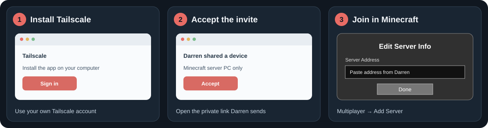

# Minecraft 26.3 friends guide

## Get started

> [!TIP]
> **Just joining? This is the only section you need.** You do not need to install mods or datapacks.

1. [Install Tailscale](https://tailscale.com/download) on the computer you play on, then **sign in**.
2. Ask Darren for a **Tailscale invitation** and the **server address**.
3. Open Darren's invitation link and select **Accept**. Keep Tailscale **connected**.
4. Launch **Minecraft: Java Edition 26.3**. Open **Multiplayer → Add Server**.
5. Enter Darren's private Tailscale address **with `:25565` at the end** (for example, `100.x.y.z:25565`), then join.

**Recommended resource pack:** For matching quality of life + visuals, download the [Friends Survival resource pack](https://github.com/gypsymagic236/minecraft-26.3-friends-pack/releases/latest/download/Friends-Survival-26.3.zip). 
In Minecraft, open **Options → Resource Packs → Open Pack Folder**, put the ZIP there **without extracting it**, and move it into the active column.

> [!TIP]
> **You're ready to play. You can stop reading here.** Everything below is an optional reference for mods, commands, and server features.

---

## More Details

**Jump to:** [Mansion Island seed guide](map.md) · [Survival progression walkthrough](survival-progression.md) · [Commands](#controls-and-commands) · [Automatic features](#things-that-happen-automatically) · [Installed packs](#server-datapacks-and-plugins)

### Controls and commands

Type commands in Minecraft chat (press **T**). **Sneak** means your normal sneak key, usually **Left Shift** unless you changed it.

#### Inventory and chests

| Feature | What to do |
| --- | --- |
| Sort your inventory | **Shift + left-click** an empty inventory slot, or **left-click outside** the inventory with an empty cursor; leaves your hotbar alone |
| Sort an open chest | **Shift + left-click** an empty chest slot |
| Put matching items into an open chest | **Shift + right-click** an empty chest slot |

#### Mining and building

| Feature | What to do |
| --- | --- |
| VeinMiner | **Sneak while mining ore**; up to 32 connected ore blocks; each block uses tool durability |
| Excavating | Type **`/excavate`** to toggle mining with any pickaxe or shovel. It starts at 3 × 3 × 3. Set your preferred size with **`/excavate size <width> <height> <depth>`**; for example, `/excavate size 5 3 2`. Width and height can be 1, 3, or 5; depth can be 1–5; maximum 75 blocks. A cyan outline previews the area, which extends into the surface. Your size is saved, while the toggle resets to off when you leave. Sneak to use VeinMiner instead. |
| Timber | Break a tree with an axe **while standing** to fell it; leaves clear and saplings drop as items |

#### Travel and waypoints

| Feature | What to do |
| --- | --- |
| Waypoint markers | `/trigger waypoint` opens shared markers by default; choose **Place Waypoint** to add one for everyone. Personal markers remain available from the menu. |
| Rename a waypoint | Stand within 4 blocks and type `/wpname <new name>`; free to rename |
| Travel to a waypoint | Select a personal or global marker in `/trigger waypoint`; travel is free, including across dimensions |
| Set and use your one home | `/trigger sethome` and `/trigger homes` |
| Return to a previous location | `/trigger back`; after a final death it returns to the death location |

Travel commands are instant and have no cooldown. New waypoint markers are shared by default.

| [Better Waypoints](https://modrinth.com/datapack/better-waypoints) |
| :---: |
|  |

#### Playing together

| Feature | What to do |
| --- | --- |
| Teleport to a player | `/tp <playername>`; no acceptance is needed |

#### Help and displays

| Feature | What to do |
| --- | --- |
| Player guide | `/trigger mcguide` |
| Toggle the coordinates HUD | `/trigger ch_toggle`; `/trigger ch_help` shows its options |

### Things that happen automatically

- **Sleep:** [Multiplayer Sleep](https://vanillatweaks.net/picker/datapacks/) lets one player skip the night; a sleep message appears in chat after five seconds.
- **Status:** [Health Indicator](https://modrinth.com/datapack/health-indicator) shows health below player names. [Durability Ping](https://vanillatweaks.net/picker/datapacks/) warns about low durability on held gear and armor with an action-bar message and sound.
- **Alerts:** [Villager Death Messages](https://vanillatweaks.net/picker/datapacks/) announces villager deaths with coordinates; [Wandering Trader Announcements](https://vanillatweaks.net/picker/datapacks/) reports nearby arrivals; [AFK Display](https://vanillatweaks.net/picker/datapacks/) grays out idle players.
- **Animations:** [Spawn Animations](https://modrinth.com/datapack/spawn-animations) makes mobs emerge with sounds.
- **After a final death:** [Graves](https://vanillatweaks.net/picker/datapacks/) saves your dropped items in a grave where you died; see the Vanilla Tweaks quick guide below to retrieve them.
- **Experience:** You keep all your XP when you die. [Clumps](https://modrinth.com/datapack/ly-clumps) combines nearby XP orbs to reduce lag. Instant pickup is off so Mending works normally.
- **Lighting:** [Dynamic Lights](https://modrinth.com/datapack/dynamic-lights-creepermeyt) lets held torches and other glowing items light up their surroundings for everyone.

| [Health Indicator](https://modrinth.com/datapack/health-indicator) | [Spawn Animations](https://modrinth.com/datapack/spawn-animations) |
| :---: | :---: |
|  |  |

### Server datapacks and plugins

These features run on the server. **Do not put them in your Minecraft resource-packs folder.**

| Area | Installed features |
| --- | --- |
| Travel and finding places | Back, Better Waypoints (free travel), Coordinates HUD, Custom Nether Portals, Elevators, Homes, Nether Portal Coords, Spawn; SimpleTPA handles player teleports |
| Mining, building, and farming | Armor Statues, Armored Elytra, Cauldron Concrete, Cauldron Mud, Chunk Loaders, Fast Leaf Decay, Glass Always Drops, More Effective Tools, Painting Picker, Redstone Rotation Wrench, Silk Touch Budding Amethyst, Timber, Villager Workstation Highlights, Wood Stripper, XP Bottling |
| Drops and recipes | Double Shulker Shells, Dragon Drops, Ender Chest Always Drops, Husks Drop Sand, Kill Empty Boats, Unlock All Recipes |
| Status and convenience | AFK Display, Clumps, Durability Ping, Dynamic Lights, Graves, Health Indicator, Multiplayer Sleep, Real Time Clock, Silence Mobs, Spawn Animations, Spawning Spheres, Track Raw Statistics, Track Statistics, Villager Death Messages, Wandering Trader Announcements |
| Server guide | Welcome Guide (the join message and `/trigger mcguide`) |

The server plugins are **NeatSort**, **SmartStash**, **InventorySortShortcut**, **VeinMiner**, **Excavating Shortcut**, **SimpleTPA**, **NeverEnoughRecipes** (with AbyssalLib), **KeepDeathXp**, and the waypoint renaming helper. The old Excavating enchant no longer appears as a new enchant. All sorting is manual. The table above covers the main commands and controls; other packs mainly change recipes, drops, displays, or automatic behavior.

#### Vanilla Tweaks quick guide

The server has **39 [Vanilla Tweaks datapacks](https://vanillatweaks.net/picker/datapacks/)**. Most work automatically; these need a special action:

- **Elevators:** Drop an Ender Pearl onto wool to make an elevator. Jump to the matching-color elevator above; crouch to go below.
- **XP Bottling:** Right-click an enchanting table with an empty glass bottle in hand. Smelt the XP bottle in a furnace to reclaim the experience.
- **Chunk Loaders:** Drop a Copper Ingot onto a Lodestone to keep its chunk loaded while the server runs. Break the Lodestone to get the ingot back. This pack is customized from [Vanilla Tweaks](https://vanillatweaks.net/picker/datapacks/).
- **Graves:** Left- or right-click your grave to retrieve your items; `/trigger graves` lists your graves. Your XP stays with you after death.
- **Armor Statues:** Type `/trigger as_help` for the armor-stand controls.

### Credits and updates

The optional visual pack is customized from [Vanilla Tweaks](https://vanillatweaks.net/). See [their terms](https://vanillatweaks.net/terms/) and the `credits.txt` inside the ZIP. Server features also use [Vanilla Tweaks datapacks](https://vanillatweaks.net/picker/datapacks/) and these projects:

- **Progression and travel:** [Better Waypoints](https://modrinth.com/datapack/better-waypoints), [SimpleTPA](https://modrinth.com/plugin/simple-tpa-vexo).
- **Inventory and mining:** [NeatSort](https://modrinth.com/project/ZgbYoHqH), [SmartStash](https://modrinth.com/project/XYbeLI5P), [VeinMiner](https://modrinth.com/project/OhduvhIc). The server's Excavating Shortcut is adapted from [Excavator Enchant](https://github.com/Derec-Mods/Excavator-Enchant/).
- **Other conveniences:** [Spawn Animations](https://modrinth.com/project/zrzYrlm0), [Health Indicator](https://modrinth.com/project/hxaUKE37), [Clumps](https://modrinth.com/datapack/ly-clumps).

When the host posts an updated pack, download the latest release and replace the old ZIP in your resource-packs folder. Your world saves and server datapacks stay on the server.
